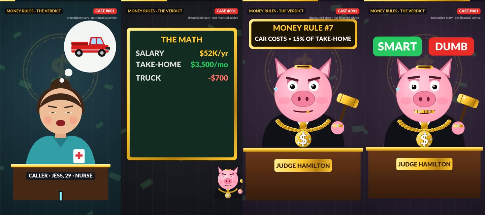
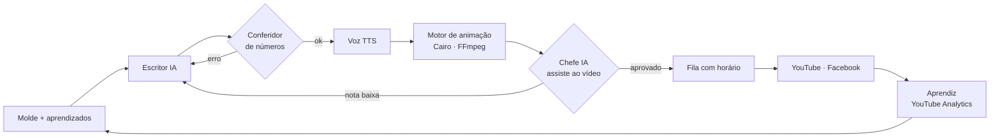

# Fábrica de vídeos com IA · do roteiro à publicação, sem edição manual

`EM PRODUÇÃO` · **Estudo de caso.** O código-fonte é proprietário e não está neste repositório.

> *EN: End-to-end pipeline that writes, fact-checks, renders, reviews and publishes short-form videos, then learns from YouTube Analytics. Python, Cairo, FFmpeg, self-hosted TTS, Docker, n8n, LLMs.*

*Quadros de um episódio gerado do zero: personagem, cenário, lousa com as contas e veredito, tudo desenhado por código.*

---

## O problema

Um canal de vídeos curtos precisa de constância: vários vídeos por semana, cada um com roteiro, voz, animação, capa, título e publicação em mais de uma rede. Feito à mão, isso toma o dia inteiro e não escala para vários canais.

## A solução

Uma linha de produção que roda sozinha no servidor e opera **vários canais** em formatos diferentes:

1. **Escritor (IA):** gera o episódio em JSON estruturado, a partir de um molde e do que funcionou antes
2. **Conferidor:** recalcula todos os números do roteiro. Se a conta da IA estiver errada, o episódio volta. O texto da IA nunca define o número que aparece na tela
3. **Motor de animação:** desenha personagens, expressões, lousa e transições quadro a quadro (Cairo + NumPy), sincroniza com a voz e exporta 1080×1920 a 30 fps
4. **Chefe de qualidade (IA multimodal):** assiste ao vídeo pronto e dá nota. Abaixo do mínimo, o vídeo é reprovado
5. **Publicação:** fila com horário, envio para YouTube e Facebook, título, descrição e capa
6. **Aprendiz:** lê YouTube Analytics (retenção, views em 48 h, inscritos, compartilhamentos), compara formatos e reescreve as orientações do escritor toda semana

## Outras peças da mesma fábrica

- **Montagem de clipes de IA generativa:** o robô transcreve cada clipe novo com Whisper, reconhece a qual roteiro ele pertence pela fala, corta no início da cena pela detecção de cortes, monta legenda e barra de progresso e publica
- **Voz própria no servidor:** TTS rodando em contêiner (Kokoro), sem custo por minuto, com voz de reserva quando um provedor falha
- **Custo controlado:** IA gratuita primeiro, paga só como reserva e com teto diário compartilhado entre os canais

## Decisões técnicas

| Desafio | Como resolvi |
|---|---|
| IA erra conta e inventa dado | Números são recalculados no código. O episódio com número errado é refeito |
| Vídeo "com cara de slide" | Animação por quadro: piscar, expressão por fala, câmera, objetos entrando em cena |
| Saber o que funciona de verdade | Janela de 48 h interpolada com origem dos dados registrada. Views acumuladas antigas não contam como 48 h |
| Publicar em massa derruba alcance | Fila com no máximo N por dia e horário fixo |
| Robô parar sem ninguém ver | Log, lock de execução e alerta no WhatsApp quando algo trava |

## Stack

## O que não está aqui (de propósito)

Prompts, moldes de episódio, regras do chefe de qualidade e o código do motor. Este repositório mostra **o que foi construído e como**.

---

Projeto de [Leonardo Magalhães](https://github.com/leomagalhaesti) · [leomagalhaesti.github.io](https://leomagalhaesti.github.io)
